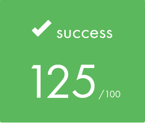

*This project has been created as part of the 42 curriculum by [atardy](https://profile-v3.intra.42.fr/users/atardy), [tschwab](https://profile-v3.intra.42.fr/users/tschwab)*

# push_swap

## Description

`push_swap` sorts a list of integers using two stacks, **a** and **b**, and a limited set of operations. The program prints the list of operations that sorts stack **a** in ascending order (smallest on top), trying to use as few operations as possible.

| Operation | Effect |
|---|---|
| `sa` / `sb` / `ss` | swap the first two elements of a / b / both |
| `pa` / `pb` | push the top of b onto a / the top of a onto b |
| `ra` / `rb` / `rr` | rotate a / b / both up (first element becomes last) |
| `rra` / `rrb` / `rrr` | reverse rotate a / b / both (last element becomes first) |

The binary embeds four strategies, selectable with a flag:

| Flag | Strategy | Complexity class |
|---|---|---|
| `--simple` | cost-based insertion | O(n²) |
| `--medium` | chunk-sort adaptation | O(n√n) |
| `--complex` | three-way quicksort | O(n log n) |
| `--adaptive` (default) | picks one of the three from the measured disorder | depends on the regime |

An optional `--bench` mode prints metrics (disorder, strategy, operation counts) to stderr.

- atardy: This project was the first group project of my cursus, so I learned a lot about using GitHub to collaborate with my teammate. On the project itself, it was interesting to learn about the algorithmic complexity of sorting algorithms. It was also really challenging to start from a simple understanding of the sorting algorithms and adapt them to the rules of push_swap and its pre-set moves. The efficiency of the algorithms was something I struggled to understand at the start, and I'm grateful to Thomas for his help and explanations!

- tschwab: Before starting this project, I had done very little with sorting algorithms; I basically didn't know any of them. So I started by learning several: bubble, insertion, selection, merge, quick, radix and shell sort. It was very interesting to discover the range of possible approaches and their strengths and weaknesses. I also found it interesting that some "less efficient" algorithms can actually beat the "better" ones in certain cases. That's why I really enjoyed writing the disorder function, which measures how unsorted an array is, and implementing the principle of an adaptive algorithm. Finally, I really enjoyed learning the most efficient way to implement each algorithm.

Evaluation result:

&nbsp;&nbsp;

## Instructions

### Compilation

```bash
make          # builds ./push_swap
make bonus    # builds ./checker (bonus)
make clean    # removes object files
make fclean   # removes object files and the binaries
make re       # fclean + make
```

### Usage

```bash
./push_swap [--simple | --medium | --complex | --adaptive] [--bench] <numbers>
```

- Numbers can be given as separate arguments (`./push_swap 3 2 1`), as one string (`./push_swap "3 2 1"`) or mixed (`./push_swap 3 2 1 "5 7 9"`). Extra spaces inside a string are ignored (`./push_swap "3  2 " 1`). The first number is the top of stack a.
- Whitespace before a number (tab, newline, `\v`, `\f`, `\r`) is accepted (`./push_swap $'\t3' 2 1`); anything after the digits is not.
- Without arguments the program displays nothing. Flags with no numbers (`./push_swap --simple`) mean there is nothing to sort, so nothing is displayed either.
- Flags come before the numbers, in any order (`--bench --simple` or `--simple --bench`). Only one strategy flag is allowed, and each flag can appear only once.
- `Error` is printed on stderr for: non-integer arguments, numbers outside the `int` range, duplicates (`1 1`, `0 -0`, `1 +1`), empty or blank arguments (`""`, `" "`), an unknown flag, a repeated flag or a flag placed after the numbers.
- Already sorted input prints no operations.
- Parsing follows the subject first. Where the subject says nothing (spacing, signs, leading zeros, whitespace before a number), it behaves like the reference checker (`fedora_checker`).

### Examples

```bash
$> ./push_swap 2 1 3 6 5 8
pb
rb
pb
rb
pb
rb
sa
pa
pa
ra
ra
pa
rra
rra
$> ARG="4 67 3 87 23"; ./push_swap --complex $ARG | ./checker $ARG
OK
$> ARG="4 67 3 87 23"; ./push_swap $ARG | wc -l
7
```

### Benchmark mode (`--bench`)

After sorting, `--bench` prints 5 lines to **stderr**; the operations stay on **stdout**:

```
$> ./push_swap --bench 4 67 3 87 23 > /dev/null
[bench] disorder:  40.00%
[bench] strategy:  Adaptive / O(n√n)
[bench] total_ops:  7
[bench] sa:  0  sb:  0  ss:  0  pa:  2  pb:  2
[bench] ra:  1  rb:  1  rr:  1  rra:  0  rrb:  0  rrr:  0
```

Use `> /dev/null` to hide the operations and see only the metrics (`2> /dev/null` does the opposite). Each command below draws a new random list, so the numbers vary a little between runs.

Simple, 100 numbers:
```bash
ARG=$(shuf -i 0-9999 -n 100 | tr '\n' ' '); ./push_swap --bench --simple $ARG > /dev/null
```

Simple, 500 numbers:
```bash
ARG=$(shuf -i 0-9999 -n 500 | tr '\n' ' '); ./push_swap --bench --simple $ARG > /dev/null
```

Medium, 100 numbers:
```bash
ARG=$(shuf -i 0-9999 -n 100 | tr '\n' ' '); ./push_swap --bench --medium $ARG > /dev/null
```

Medium, 500 numbers:
```bash
ARG=$(shuf -i 0-9999 -n 500 | tr '\n' ' '); ./push_swap --bench --medium $ARG > /dev/null
```

Complex, 100 numbers:
```bash
ARG=$(shuf -i 0-9999 -n 100 | tr '\n' ' '); ./push_swap --bench --complex $ARG > /dev/null
```

Complex, 500 numbers:
```bash
ARG=$(shuf -i 0-9999 -n 500 | tr '\n' ' '); ./push_swap --bench --complex $ARG > /dev/null
```

Verify with the checker while saving the metrics to a file:

```bash
ARG=$(shuf -i 0-9999 -n 500 | tr '\n' ' '); ./push_swap --bench $ARG 2> bench.txt | ./checker $ARG; cat bench.txt
```

### Checker (bonus)

```bash
make bonus    # builds ./checker
```

```bash
./checker <numbers>
```

```bash
ARG="87 4 67 3 23"; ./push_swap $ARG | ./checker $ARG
```

The checker takes the same numbers as push_swap (same parsing rules), builds its own stacks from them, reads a list of moves from stdin (one per line, usually push_swap's output), applies them and prints:

| Output | Stream | When |
|---|---|---|
| `OK` | stdout | every move was valid, stack a is sorted and stack b is empty |
| `KO` | stdout | every move was valid, but a is not sorted or b is not empty |
| `Error` | stderr | something is invalid: a bad argument (same rules as push_swap, including empty or blank arguments), an unknown move, a wrong case, extra spaces, an empty line, a last move without its final newline… |

Without arguments, `./checker` prints nothing and doesn't read stdin.

Where the subject is explicit, our checker follows it rather than the provided reference binary (`fedora_checker`):

| Case | Subject / our checker | Reference binary |
|---|---|---|
| Duplicate numbers (`1 1`) | `Error` | accepted |
| No arguments | nothing | `OK` |
| Empty argument (`"" 1`) | `Error` | accepted |
| Last move without `\n` (`printf 'sa'`) | `Error` | accepted |
| Move followed by `\r` (`sa\r`) | `Error` | accepted |

Everywhere else, the two give the same result.

```bash
$> printf 'sa\n' | ./checker 2 1 3
OK
$> printf 'ra\n' | ./checker 2 1 3
KO
$> printf 'sa \n' | ./checker 2 1 3
Error
$> ./checker
$>
```

## Algorithms

### Shared groundwork

**Flags.** The flags are read from the start of the arguments, in any order, until the first argument that isn't a valid flag; everything after that is parsed as numbers. Each strategy selector or `--bench` sets the `flag` or `bench` value of `stack_a`. If no strategy is given, adaptive is used. A flag given twice, or placed after the numbers, ends up being parsed as a number and gives `Error`. Flags with no numbers mean there is nothing to sort, so nothing is printed. Time O(argc), space O(1).

**Data structure.** Each stack is a circular doubly linked list with a wrapper struct (`top`, `size`, counters), so every operation is O(1): a swap changes 6 pointers, a push 4, a rotation only moves `top`.

**Duplicate check.** Each integer is checked against the whole list to make sure there's no duplicate. Time O(n²), space O(1).

**Disorder.** The share of pairs `(i, j)` with `i < j` that are in the wrong order (`a[i] > a[j]`), over all pairs. 0 % = sorted, 100 % = reverse sorted. Stored as an integer ×100 (rounded) so it can be printed with two decimals without floats. Time O(n²) (every pair once), space O(1).

**Ranks.** Before sorting, each number is replaced by its rank `0 … n-1` (`rank_parsing`). All algorithms then work on ranks, so pivots and targets never depend on the actual values. Time O(n²), space O(1) (the rank is stored in each node).

### Simple — O(n²): cost-based insertion

1. Push everything except 3 numbers to b. While pushing, numbers ranked below the middle are rotated to the bottom of b (`rb`), so b is roughly split in two halves already. This only adds O(n) moves.
2. Sort the 3 numbers left in a directly (at most 2 moves).
3. Repeatedly move back the **cheapest** number of b: for each number in b, compute how many rotations bring it to the top of b and its target position to the top of a, comparing the 4 combinations (`ra`+`rb`, `rra`+`rrb`, `ra`+`rrb`, `rra`+`rb`). Rotations in the same direction are shared as `rr` / `rrr`. Then `pa`.
4. Rotate the smallest number to the top the shorter way.

**Complexity.** n insertions, each costing at most O(n) rotations, and finding the cheapest one scans b: **O(n²) time**. Space: O(1) besides the stacks.

### Medium — O(n√n): chunk sort

The ranks are divided into chunks of consecutive values. The chunk size is ⌊√n⌋ × 11/4: the factor 11/4 (the `tweaker`) was tuned by measuring operation counts, and the size stays proportional to √n, so the complexity class doesn't change.

1. Push everything except the 3 largest numbers to b, chunk by chunk: each time, the closest number of the current chunk (from the top or the bottom of a) is brought to the top and pushed. Numbers in the lower half of the chunk are rotated down in b (`rb`, combined with `ra` as `rr` when possible). It's a kind of "pre-sort".
2. Sort the 3 numbers left in a directly (at most 2 moves).
3. Push the numbers back from b to a, biggest first:
	- Compute the cost of bringing the biggest value still in b to the top, and the cost of bringing the second biggest.
	- If the biggest is cheaper: bring it to the top of b and push it to a.
	- If the second biggest is cheaper: bring it to the top and push it to a, then do the same with the biggest, and swap them with `sa` so they end in the right order.

**Complexity.** The numbers are split into about √n chunks of about √n numbers each (up to the constant factor). Pushing everything to b takes one pass over a per chunk, which is O(n√n) moves. Because b is then roughly sorted by chunk, the biggest numbers are never more than about √n positions from an end of b, so each push back costs O(√n), which is also O(n√n) in total: **O(n√n) time**. Space: O(1) besides the stacks.

### Complex — O(n log n): three-way quicksort

1. The whole stack a is one *chunk*: a range of ranks plus its location (top or bottom of a or b).
2. Two pivots split the chunk's range into exact thirds (`min + size/3`, `min + 2·size/3`). Each number is sent to one of the other stack ends depending on its third, so the three parts land in three different places.
3. Recurse on the big, middle and small parts, in that order, each with its new location.
4. Chunks of 3 or fewer are sorted directly. If the 3 numbers are alone in a, plain rotations are used (at most 2 moves); otherwise a sequence that doesn't disturb the numbers below.
5. A chunk at the bottom of a stack it is alone in is treated as being at the top (same nodes), which saves the moves to bring it up.

**Complexity.** Pivots by rank always split into exact thirds, so there are about log₃(n) levels, and each level moves every number a constant number of times: **O(n log n) time, worst case included**. Space: O(log n) for the recursion depth.

### Adaptive

| Measured disorder | Regime | Method | Class |
|---|---|---|---|
| < 20 % | low | cost-based insertion (Simple) | O(n²) |
| 20 % – 50 % | medium | chunk sort (Medium) | O(n√n) |
| ≥ 50 % | high | three-way quicksort (Complex) | O(n log n) |

Disorder is computed once before sorting. Already-sorted input (0 %) prints nothing.

**Rationale for the thresholds.** The two limits (20 % and 50 %) come from the subject, which ties each disorder regime to a complexity class. Our job was to pick, for each regime, a method of the required class that makes sense for that kind of input. We measured every strategy on inputs of controlled disorder to check those choices:

| Disorder | Simple (100) | Medium (100) | Complex (100) | Simple (500) | Medium (500) | Complex (500) |
|---|---|---|---|---|---|---|
| 3 % | 364 | 389 | 665 | 2156 | 2894 | 4405 |
| 16 % | 428 | 517 | 667 | 2651 | 4363 | 4414 |
| 21 % | 457 | 545 | 667 | 3143 | 4695 | 4414 |
| 45 % | 563 | 602 | 667 | 4395 | 5313 | 4411 |
| 50 % | 578 | 618 | 667 | 4548 | 5306 | 4412 |
| 75 % | 499 | 592 | 668 | 3392 | 4884 | 4408 |
| 100 % | 299 | 399 | 668 | 1499 | 2014 | 4412 |

*Average number of operations (20 inputs per row for 100 numbers, 6 for 500).*

- **Low disorder (< 20 %): cost-based insertion.** On nearly sorted input most numbers are already close to their final place, so the cheapest insertion only needs a few rotations each time. It is by far the cheapest method here (about half the operations of quicksort).
- **Medium disorder (20 % – 50 %): chunk sort.** The subject requires an O(n√n) method in this range. Chunk sort pushes ranges of ranks of size proportional to √n to b, so its cost depends on how scattered each range is, which is why it grows with the disorder.
- **High disorder (≥ 50 %): three-way quicksort.** Its pivots are chosen by rank, so every split is exactly in thirds whatever the input looks like: the cost is the same at 50 % or 100 % disorder (about 667 for 100 numbers, 4412 for 500). That guaranteed O(n log n), worst case included, makes it the safe choice when the input is the most chaotic.

The measurements also show that our cost-based insertion often beats the other two even on random input. This does not contradict its O(n²) class: O(n²) is the worst-case upper bound (each of the n insertions could need up to n rotations), and always picking the cheapest insertion keeps the real count well below it.

**Complexity.** In the Push_swap model only the operations printed on stdout count. Before choosing a method, adaptive runs two preparation steps on stack a:

- `disorder` compares every pair of numbers once: n(n−1)/2 comparisons, O(n²) CPU time.
- `rank_parsing` gives each number its rank (0 to n−1) in n passes over the stack: O(n²) CPU time.

Neither step prints a single operation, so they add **0 operations**: they only read the stack. The operations of adaptive are therefore exactly those of the method it picks, which gives the upper bound required for each regime:

| Regime | Method | Operations (time) | Extra space |
|---|---|---|---|
| < 20 % | cost-based insertion | O(n²) | O(1) |
| 20 % – 50 % | chunk sort | O(n√n) | O(1) |
| ≥ 50 % | three-way quicksort | O(n log n) | O(log n) (recursion) |

Space: the disorder and the ranks need O(1) extra memory (the ranks are stored in the nodes themselves), so adaptive uses the space of the chosen method, on top of the O(n) of the two stacks.

### Why not other algorithms

Only the four stack ends are cheap to reach. Anything that needs random access, many separate buckets or fixed full passes pays for it in rotations.

| Algorithm | Problem on two stacks | Approx. ops (100 / 500) |
|---|---|---|
| Selection / min extraction | rotates to the minimum every time | ~2,700 / ~63,500 |
| Plain insertion (not cheapest-first) | ignores the cost of each insertion | ~2,500+ / — |
| Bubble sort | only adjacent swaps | up to ~10,000 / — |
| Merge sort on two stacks | merging needs many rotations | ~1,000–1,400 / ~7,000–9,000 |
| Two-way quicksort | log₂ instead of log₃ levels, uses fewer stack ends | more than three-way |

## Performance

Targets for the best tier: **< 700** operations for 100 numbers, **< 5500** for 500.

| Strategy | 100 avg / worst | 500 avg / worst |
|---|---|---|
| `--simple` | 569 / 632 | 4547 / 4893 |
| `--medium` | 606 / 670 | 5289 / 5627 |
| `--complex` | 666 / 675 | 4413 / 4435 |
| `--adaptive` (random input) | 629 / 675 | 4778 / 5561 |

*Measured on the final build: 100 random inputs per row, values spread across the whole `int` range, each output checked for correctness.*

On random input the disorder is close to 50 %, so adaptive uses chunk sort in some runs and quicksort in the others; the runs that go over 5500 for 500 numbers are the ones where it picked chunk sort.

Small inputs: 3 numbers in at most 2 operations, 5 numbers in at most 11 (12 with `--medium`).

## Contributions

**atardy**
- **Argument parsing:** flags, numbers as one string or as separate arguments, integer validation and overflow, duplicates, building and freeing the stacks.
- **Operations:** `sa` `sb` `ss` `pa` `pb`.
- **Medium algorithm**, O(n√n).
- **Error handling**.

**tschwab**
- **Disorder, ranks and adaptive dispatch**
- **Operations:** `ra` `rb` `rr` `rra` `rrb` `rrr`.
- **Simple and Complex algorithms**, O(n²) and O(n log n).
- **`--bench`.**
- **Checker** (bonus), including the rule that every move must end with a newline.
- **Parsing:** corrections to handle `+`, leading `0`, extra spaces, whitespace before a number, empty or blank arguments, and flags given without numbers.

**Both**
- Data structure design, Makefile, README, function briefs.
- Code reviews through pull requests.

## Resources

### References

- The subject of "Push_Swap" by 42 school: https://github.com/TomSwb/push_swap/blob/59fca7d7f299e73b4a2c01b5ab2b4e4872bc324d/ressources/en.subject.pdf
- 42 fedora_checker.

#### atardy:

- GeeksforGeeks, all the sorting algorithms that we used: https://www.geeksforgeeks.org/dsa/sorting-algorithms/

#### tschwab:
- YouTube:
	1. [15 algo in 6 minutes](https://youtu.be/kPRA0W1kECg?is=gyUgX_jdO5FwnP0U)
	2. [Radix Sort Explain](https://youtu.be/UyFH-KayvM4?is=hnHo3rKhdnE2hqAN)

- TikTok: different algorithm videos (sorry, no links).

### AI

#### tschwab

⚠️ Disclaimer: I only ask for actual answers when I realise I am missing theoretical knowledge, e.g. a new syntax or a concept I had not explored before.

I always write my code to the best of my abilities first. AI never wrote my code, and I do not copy-paste from AI into my code. My AI agent is set to guide me as a peer, following the 42 pedagogical philosophy: questions and explanations, short snippets only to show a new syntax, never full solutions.

Everything AI suggested was checked: tested with the checker and the generator, measured against the benchmark targets, and reviewed with my project partner through pull requests.

- `Claude:` (O(n²) `--simple` and O(n log n) `--complex` parts, final testing and README)
	1. Back-and-forth discussion to compare sorting strategies and their trade-offs on two stacks, before choosing cost-based insertion and three-way quicksort.
	2. Checking my reasoning on the complexity of each algorithm in the project's complexity model.
	3. Explaining new syntax and concepts (e.g. enums, passing structs by pointer) with short examples.
	4. Guiding my debugging and optimisation with questions, to bring move counts under the benchmark targets.
	5. Help in learning the git workflow used with my partner: feature branches, rebases, pull requests.
	6. Shell commands to automate tests (random inputs, move counts, checker).
	7. Reviewing the function briefs and README parts I wrote first, for wording and completeness.
	8. Final test batteries before the evaluation (parsing compared with the subject and the reference checker, memory leaks, operation counts): it listed what to fix, and I coded the fixes myself, guided step by step.
	9. Drafting the adaptive "Rationale for the thresholds" and "Complexity" sections, generating the measurement tables (operations by disorder, performance) and proofreading this README; all of it was then reviewed and revised with my partner.

#### atardy

I never asked any AI for code review or code generation, but I used it to understand some concepts, especially the bucket-sort algorithm.

- `ChatGPT & Claude:`
	1. Confirming my understanding of the (unused) bucket sort and checking that it was a viable choice (regarding the efficiency benchmark) before coding it myself.
	2. Helping with git for specific cases not covered by the document that Thomas provided.
	3. Helping me find a good way to explain things in some of my parts of this README.